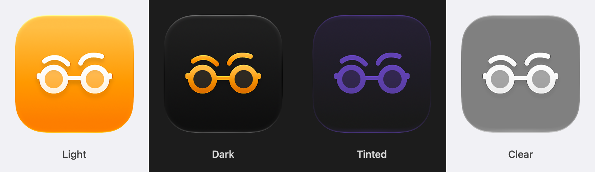

<!-- Modified in this fork (taehee-pd/harperSwift): adds the "Harper Desktop for macOS" section below the badges. -->

<div id="header" align="center">
    
    <h1>Harper</h1>
</div>

[](https://github.com/automattic/harper/actions/workflows/binaries.yml)
[](https://github.com/automattic/harper/actions/workflows/build_web.yml)
[](https://github.com/automattic/harper/actions/workflows/just_checks.yml)
[](https://crates.io/crates/harper-ls)


## Harper Desktop for macOS (this fork)

<p align="center">
  <picture>
    <source media="(prefers-color-scheme: dark)" srcset="harper-desktop/assets/app-icon-dark.png">
    
  </picture>
</p>

This fork makes Harper Desktop a Mac app that feels native on Apple Silicon.
Harper still checks your writing on your Mac, in the apps you enable, without sending your text anywhere.

- **Native suggestion popup.** Suggestions open in a SwiftUI panel, with Liquid Glass on macOS 26 and later. The app you are typing in keeps focus.
- **Clarity suggestions.** Optional suggestions from Apple's on-device model for sentences that are correct but wordy or awkward. They have a dashed violet underline, never apply on their own, pause in Low Power Mode, and can be turned off in Settings. They need macOS 27 and Apple Intelligence, and your text stays on your Mac.
- **A new app icon,** described below.

### The icon

<p align="center">
  
</p>

The icon keeps Harper's mark: round reading glasses under raised brows.
The glasses stand for reading closely, and the raised brows are the look you give a sentence that could be better.
It is redrawn for macOS in Icon Composer:

- A white Liquid Glass glyph on amber, Harper's brand color.
- The lenses are their own layer of clear glass, so the background shows through them like real lenses.
- The strokes are heavier than the logo's, so the mark stays legible at Dock and Finder sizes.
- Light, dark, tinted and clear versions follow the icon appearance you choose in System Settings.

The source is [`harper-desktop/src-tauri/icons/icon.icon`](harper-desktop/src-tauri/icons/icon.icon); [the icons README](harper-desktop/src-tauri/icons/README.md) explains how it is built and used.

### Download

Get the latest disk image from [Releases](https://github.com/taehee-pd/harperSwift/releases/latest). It runs on Apple Silicon Macs with macOS 13 or later, and updates itself from this repository's releases.
From 1.2.1, releases are signed with a Developer ID and notarized by Apple, so they open normally, and Harper keeps its Accessibility permission across updates.
Releases up to 1.2.0 were signed ad hoc: macOS blocks them the first time (run `xattr -dr com.apple.quarantine /Applications/Harper.app`, or choose Open Anyway in System Settings → Privacy & Security), and the update to 1.2.1 asks for Accessibility permission one last time.

### Build it

You need an Apple Silicon Mac with macOS 13 or later (Clarity needs macOS 27), Xcode 26 or later, and the tools from the [contributor setup](https://writewithharper.com/docs/contributors/environment), including `just` and `wasm-pack`.

```bash
just build-desktop-macos-unsigned
```

The app and disk image are written to `harper-desktop/src-tauri/target/aarch64-apple-darwin/release/bundle/`.
The build is signed ad hoc for your Mac only, so macOS asks for Accessibility access again after each rebuild.
To publish a release with update files, see [`harper-desktop/RELEASING.md`](harper-desktop/RELEASING.md).

The rest of this README is Harper's own.

Harper is an English grammar checker designed to be _just right._
I created it after years of dealing with the shortcomings of the competition.

Grammarly was too expensive and too overbearing.
Its suggestions lacked context, and were often just plain _wrong_.
Not to mention: it's a privacy nightmare.
Everything you write with Grammarly is sent to their servers.
Their privacy policy claims they don't sell the data, but that doesn't mean they don't use it to train large language models and god knows what else.
Not only that, but the round-trip-time of the network request makes revising your work all the more tedious.

LanguageTool is great, if you have gigabytes of RAM to spare and are willing to download the ~16GB n-gram dataset.
Besides the memory requirements, I found LanguageTool too slow: it would take several seconds to lint even a moderate-size document.

That's why I created Harper: it is the grammar checker that fits my needs.
Not only does it take milliseconds to lint a document, take less than 1/50th of LanguageTool's memory footprint,
but it is also completely private.

Harper is even small enough to load via [WebAssembly.](https://writewithharper.com)

## Language Support

Harper currently only supports English, but the core is extensible to support other languages, so we welcome contributions that allow for other language support.

## Performance Issues

We consider long lint times bugs.
If you encounter any significant performance issues, please create an issue on the topic.

If you find a fix to any performance issue, we would appreciate the contribution.
Just please make sure to read [our contribution guidelines first.](https://writewithharper.com/docs/contributors/introduction)

## Links

- [Frequently Asked Questions](https://writewithharper.com/#faqs)
- [Obsidian Documentation](https://writewithharper.com/docs/integrations/obsidian)
- [`harper-ls` Documentation](https://writewithharper.com/docs/integrations/language-server)
- Supported Editors' Documentation
  - [Visual Studio Code](https://writewithharper.com/docs/integrations/visual-studio-code)
  - [Neovim](https://writewithharper.com/docs/integrations/neovim)
  - [Helix](https://writewithharper.com/docs/integrations/helix)
  - [Emacs](https://writewithharper.com/docs/integrations/emacs)
  - [Zed](https://writewithharper.com/docs/integrations/zed)
- [`harper.js` Documentation](https://writewithharper.com/docs/harperjs/introduction)
- [Official Discord Server](https://discord.com/invite/JBqcAaKrzQ)

## Huge Thanks

This project would not be possible without the hard work from those who [contribute](https://writewithharper.com/docs/contributors/introduction).

<a href="https://github.com/automattic/harper/graphs/contributors">
  
</a>

Harper's logo was designed by [Lukas Werner](https://lukaswerner.com/).
